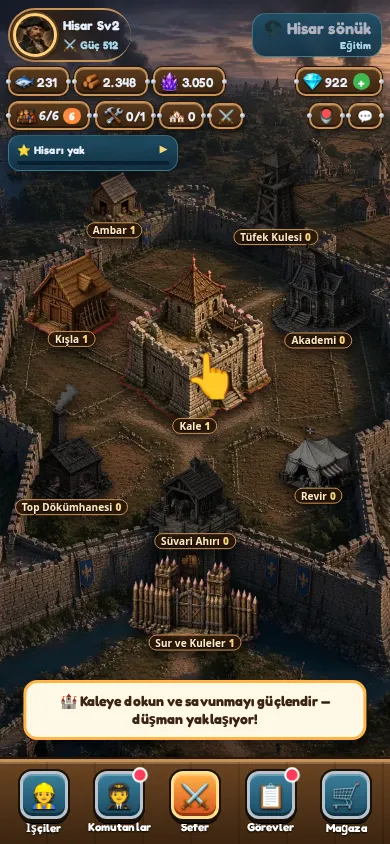
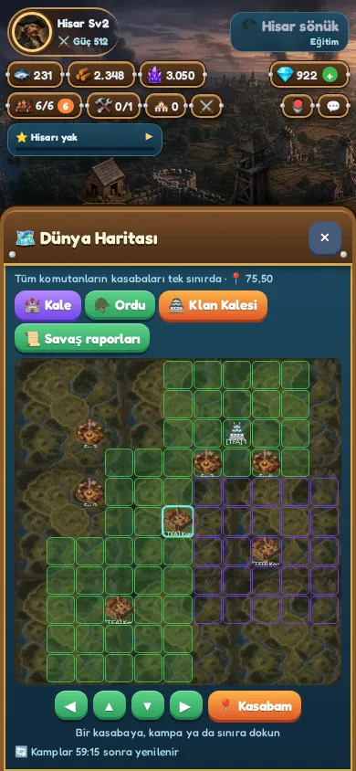
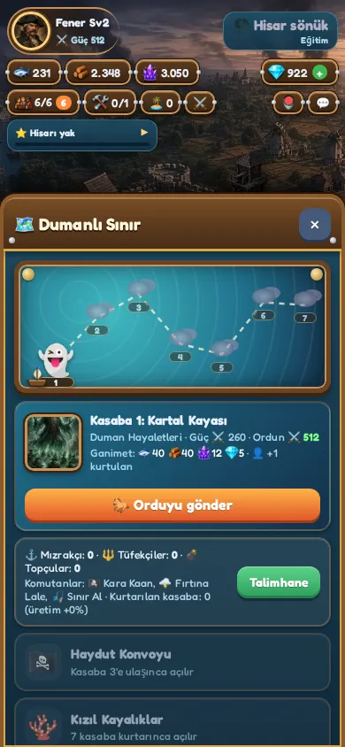
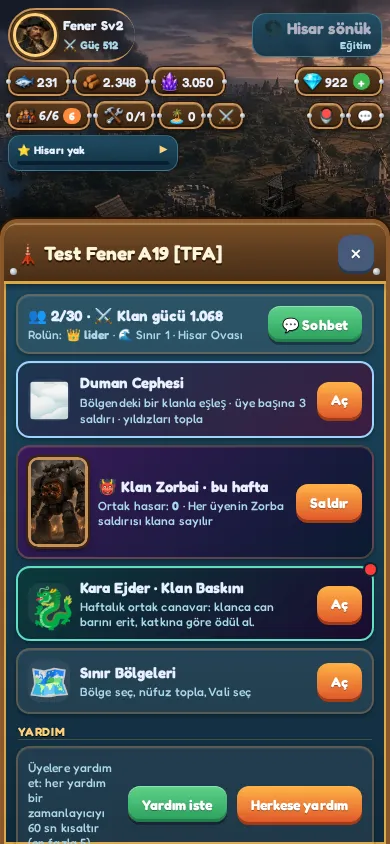
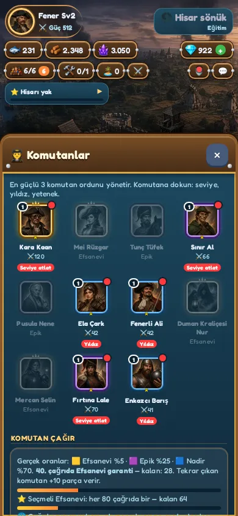

# Starfort — Barut Çağı

Tarayıcıda (mobil öncelikli, PWA) oynanan bir **barut çağı kale-şehir strateji oyunu**. 1600–1800'ler: surlarla çevrili bir şehri büyüt, mızrakçı, tüfekçi, süvari ve topçu birlikleri yetiştir, kara haritasında komşu kasabaları fethet ve klanınla birlikte savaş.

**Canlı:** https://umutcandar.github.io/son-fener/

| Şehir | Dünya haritası | Sefer haritası | Klan | Komutanlar |
|---|---|---|---|---|
|  |  |  |  |  |

## Ana döngü: savaş
1. **Üret** — Şehir binaları tahıl, kereste ve barut/kristal üretir.
2. **Yetiştir** — Kışla, Tüfek Kulesi, Top Dökümhanesi ve Süvari Ahırı'nda birlik eğit.
3. **Sefere çık** — Haritada kasaba kurtar, haydut konvoylarını vur, ganimet topla.
4. **Güçlen** — Komutanları ve araştırmayı yükselt, ön/arka hat dizilişini kur, tekrar saldır.

## Dünya haritası
Kara haritası bölgelere ayrılır. Kasabalar, haydut kampları ve bölge valiliği için diğer oyuncularla ve klanlarla rekabet edilir; kalkan, yürüyüş ve iyileşme sunucu tarafında doğrulanır.

## Klanlar
Klan sohbeti, yardım isteme/hızlandırma, bağış ve klan dükkanı, haftalık ortak savaş lordu (boss) ve klan baskınları, bölge sıralaması.

## Şehir binaları
Kale (merkez), Ambar, Kışla, Tüfek Kulesi, Top Dökümhanesi, Süvari Ahırı, Akademi (araştırma), Revir (yaralı iyileştirme), Sur ve Kuleler.

## Birlik hatları
| Hat | Rol |
|---|---|
| 🛡️ Mızrakçılar | Ön hat, dayanıklı yakın dövüş |
| 🎯 Tüfekçiler | Menzilli ana hasar |
| 🐎 Süvari | Hızlı kanat, baskın |
| 💣 Topçular | Kuşatma, sur ve kule hasarı |

(Sunucu kimlikleri geriye dönük uyum için değişmedi: `tayfa`, `zipkin`, `topcu`…; yalnız görünen adlar değişti.)

## Teknik
- Saf JS + three.js, derleme adımı yok; service worker ile çevrimdışı.
- Supabase (Postgres + RLS + RPC): hesap, kayıt (çakışmada en yeni `saved` kazanır), savaş, klan, sohbet.
- 11 dil (tr, en, de, es, fr, pt-BR, ru, zh-CN, zh-TW, ar, id); kontrol: `python3 tools/check_i18n.py`.
- **Ödemeler DEMO'dur:** gerçek para alınmaz. Oranlar dürüst gösterilir, ücretsiz oyun tam oynanabilir.

## Yerel çalıştırma
```bash
python3 -m http.server 8770
# http://localhost:8770/
```
